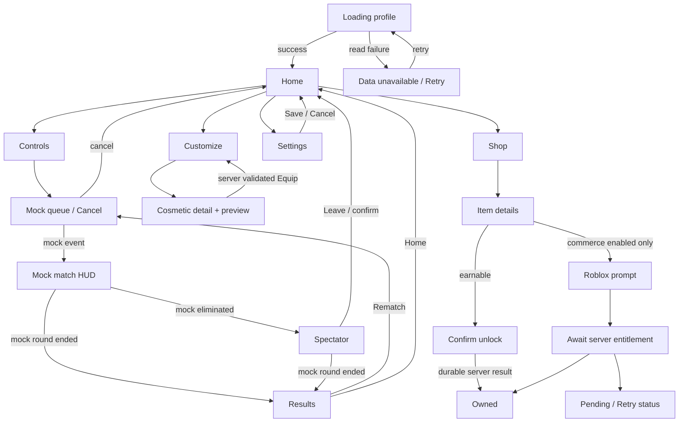

# Trail Wars proposed UX flow

Status: **PROVISIONAL**, authored while the Steam reference traversal remains incomplete. This document describes intended behavior and test contracts, not verified multiplayer functionality. The build must label all queue, match, elimination and result events driven by the harness as **MOCK**.

Pitch: “Steer left or right. Your trail becomes a wall. Don't crash. Last survivor wins.” The product uses abstract moving cores, fixed overhead view and one mode. Four to eight participants and 45–90 second rounds are test hypotheses; they are not finalized rules.

Primary navigation is Play, Customize, Shop and Settings. Profile is a compact secondary panel reachable from home, not another primary destination. Parties, chat, ranked modes, currency packs, pass seasons and replay pages are deferred. All later destinations remain absent from the launch navigation rather than appearing as dead controls.

First-time flow: load authoritative data before displaying ownership or balance; show one short controls page when Play is selected; let returning users skip it through an explicit “Don't show before Play” setting. The tutorial explains auto-movement, hold-left/hold-right, and release-to-straighten. It includes the actual current input glyphs but never assumes controller hardware is connected. A local visualization may illustrate turns; it must be labeled demonstration and must not grant progress.

During mock testing: queue states are idle, joining, queued, canceling, canceled, timed out and failed. A cancellation request has an identifier and a single terminal result so a late match-start event cannot launch a canceled ticket. Until real matchmaking exists, every state contains “Mock flow — no multiplayer match.” User-triggered harness advancement remains clearly separated from normal production controls.

During a future real round: the simulation owns movement, collisions and results; UI consumes typed server events. The interface owns only steering intent and display. Elimination offers spectate, next-player focus and leave; it does not sell revives. Results show placement and reconciled rewards, offer Rematch and Home, and distinguish “Rewards saving” from a confirmed grant. A client reconnect never invents a win or awards missed XP locally.

Cross-device input: keyboard A/D or arrows; touch left/right buttons that support holding and release/cancel; gamepad directions mapped to the same two signed intents. Simultaneous opposing steering resolves to neutral by a documented rule. Opening a modal releases held steering. App focus loss, controller disconnect and touch cancellation clear intent. Menus use a separate focus context from steering.

Settings draft changes apply locally for preview, but Save sends a validated settings request. Cancel restores the last accepted settings. Failed save preserves the draft and offers Retry; returning Home does not imply persistence succeeded. Account and privacy controls remain Roblox-owned; no duplicate authentication flow is added.

Data errors block spending and equip mutations until an authoritative profile exists. Read failure must never create/save a new default over an existing profile. Reconnect and failed saves display actionable status, with no pressure to buy. Purchase success is driven by authoritative entitlement confirmation, not platform prompt closure.
