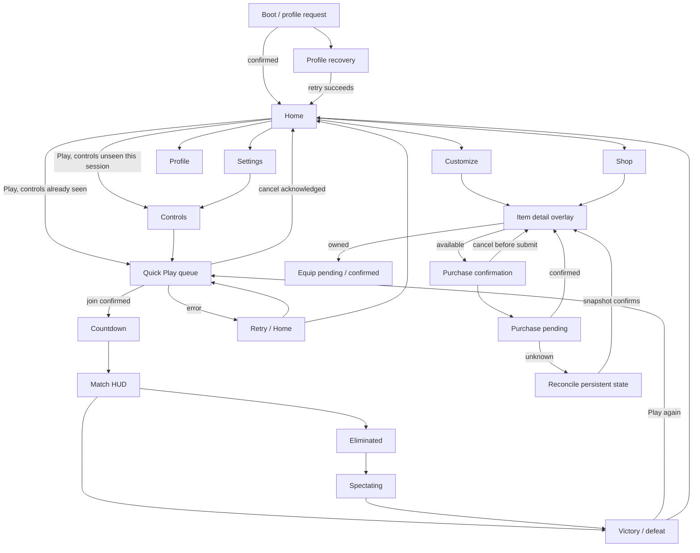

# Navigation, state machines and input contracts

Proposal only. Routes are few; most detail/error states are overlays or state variants rather than new navigation destinations.

## Parent-child hierarchy

App owns session, profile and transaction controllers, independent of route mounts. Root locations: Home, Customize, Shop, Profile, Settings. Play flow is a sibling state machine, not a sixth tab. Item details retains its parent location and selected item; purchase confirmation sits above item details. Entry recovery can cover Home without creating a second navigation root.

Presentation hierarchy, bottom to top: background → route shell/content → fixed navigation/action rail → nonblocking status → scrim/dialog → platform CoreGui. Dialog dismiss does not destroy its parent controller. Only one detail and one nested confirm can be open. A connection warning never creates another nested confirm.

## Back and modal behavior

| Context | Back / Escape / controller B | Focus after action |
|---|---|---|
| Root secondary route | Home | Invoking Home nav button |
| Controls from Play | Home | Play |
| Controls from Settings | Settings | Review Controls row |
| Item detail | Close to invoking collection/shop state | Same item ID, not list index |
| Purchase confirm, before submission | Return to item detail | Unlock button |
| Purchase pending | Close presentation only if controller retains request; cannot cancel or declare refunded | Parent item + persistent pending banner |
| Unknown purchase outcome | Browsing allowed, writes gated; closing banner cannot clear uncertainty | Reconcile action |
| Queue | Request cancel; remain canceling until acknowledgement | Play after cancel |
| In match / spectator | Open leave confirmation; game does not pause | Stay by default; original invoking control on cancel |
| Results | Home; Play again is explicit | Play |
| Boot recovery | Remains readable; help/error identifier available | Retry, never destructive reset |

Current App blocks navigation while requests are pending. The proposed nonblocking browsing policy is a client-state refactor to review after approval; it does not exist yet. It must retain the existing stale-response and unresolved-write barriers.

## State reducers (future UI architecture)

- **Route:** location + return context + selected item/category + scroll position. Navigation uses stable keys. History is bounded, root selection replaces history, not an unbounded trail of tab clicks.
- **Profile:** idle → loading → confirmed; loading → recoverable failure / incompatible; confirmed → stale on disconnect; Retry → loading. No invented default snapshot.
- **Transaction:** idle → confirming → submitting → success / business rejection / unknown. unknown → reconciling → known owned / known not bought / still unknown. Only known states permit another write.
- **Equip:** idle → submitting → confirmed / rejected / unknown. Cosmetic preview may change locally, but equipped badge changes only on confirmation.
- **Match presentation:** controls → queue → joining → countdown → active → eliminated/spectating → results. Inputs are future authoritative events with matchId correlation; current stories remain mocks.
- **Settings:** local draft → per-field saving → confirmed / rejected. Preference display distinguishes unsaved draft from server confirmation. Restore defaults reports partial success if only some fields save.

## Input and focus

Home focus order: Play, Customize, Shop, Profile, Settings, optional connection action. Keyboard Tab/Shift-Tab traverses semantic order; Enter/Space activate. Controller D-pad follows explicit spatial neighbors; A activates, B goes back. Decorative art/currency never enters the focus list. Pointer hover never moves controller focus.

Collection order: Back, Core/Trail tabs, visible item tiles in row order, Preview Details, Equip/Unlock, navigation. Dialog order: title announcement, close/cancel, confirm. Destructive or charge confirmation never receives automatic initial focus; Cancel/Stay does. A modal traps focus until closed; all underlying controls are inactive. Hide/unmount removes controls from the focus graph. Restore by route+item ID, using nearest surviving item then tab if the item disappears.

Touch uses visible pressed bounds, 48px minimum practical target and 8px separation. No action requires hover. Switching mouse→controller→touch updates hints, focus indicator and touch controls without resetting selection, opening a route or moving the layout during a press. Device disconnect clears held steering intent. System menus/focus loss also clear intent.

## Eight priority journeys

1. New session: profile confirmed → Home → Play → three-rule Controls → Continue → mock queue. Cross-session skipping awaits a preference contract.
2. Returning in session: Home → Play → queue; no mode-selection interstitial.
3. Home → Customize → select owned cosmetic → Equip → confirmed checkmark; Back restores Home nav.
4. Home → Shop → Ring core details → 150-coin confirmation → server-confirmed ownership → Equip. Insufficient balance explains cost without upsell pressure.
5. Active mock presentation → eliminated → spectator → results. No local stat grant.
6. Results → Play again → queue. Settlement can remain pending without blocking browsing.
7. Cancel before submitting purchase → unchanged balance, item detail. Canceling a native paid prompt is later-only and cannot be treated as an entitlement result.
8. Connection failure → durable Retry/Reconcile → fresh Snapshot → known state. Unknown transaction outcome never becomes a second charge or a fake failure.

Deep-linking items is internal only for MVP: {sourceRoute,itemId,category}. Validate against Catalog, fall back to collection with a clear unavailable message. No public/social deep links are required.
